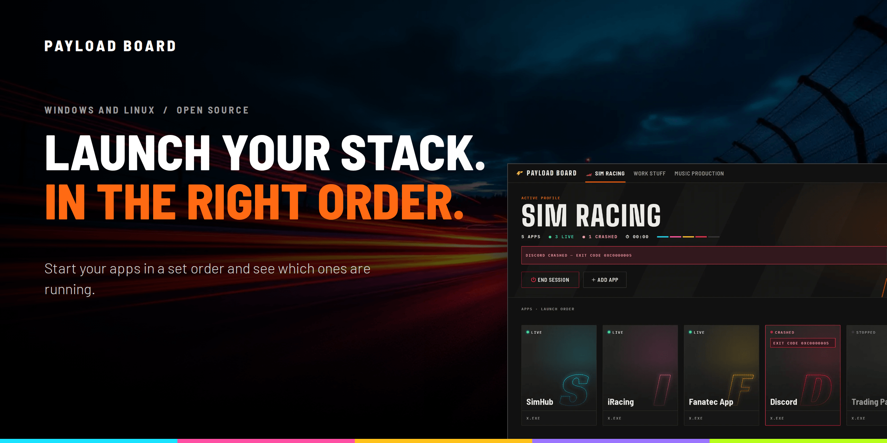

# Payload Board



Payload Board is a desktop app for managing sets of applications, which it calls profiles. It starts them in order, shows which ones are running, and closes the whole set with one click.

I wrote it because every sim racing session meant starting a dozen apps in the right order and, afterwards, closing them one by one. Payload Board does that for me.


<sub>The screenshots use sample data. The same screen in the [grey](docs/assets/screenshots/grey-1280x800-grid.png) and [light](docs/assets/screenshots/light-1280x800-grid.png) themes, the [list view](docs/assets/screenshots/dark-1280x800-list.png) and the [settings](docs/assets/screenshots/dark-1280x800-settings.png).</sub>

## What it does

1. Create a named profile, for example `Racing`, `Work` or `Stream`. You can give it an accent colour and a cover image.
2. Add apps to the profile. Each one has a place in the launch order, an optional delay and optional command-line arguments.
3. Press Run sequence. The apps start one at a time in that order. The button shows the current step, and pressing it again cancels the rest.
4. The dashboard shows a tile per app with its current status.
5. Stop, restart or open the folder of any single app from its tile.
6. End session closes every app in the profile gracefully and force-kills any that are still open after five seconds.
7. Profiles are saved between runs. Switch between them in the tabs at the top.

You can drive all of it from the keyboard. `Ctrl+K` opens a command palette, and global shortcuts work while a game has focus.

## Features

Profiles and apps
- Profiles with an emoji, an accent colour and a cover image
- Launch order, delay and command-line arguments per app
- Process priority per app: Low, Normal or High
- "Launch minimised" per app (Windows only)
- Poster view and list view, with an A to Z or Z to A display sort
- Confirmation before an app is removed or a profile is deleted

Running a session
- The sequencer runs in the backend, so it keeps going when the window is hidden
- Apps that are already running are adopted instead of being started twice
- A system notification when an app crashes and the window is not in front
- Optional auto-restart per app, with a limit on attempts
- The hero shows live and crashed counts, the launch-order strip and a session timer

Keyboard
- Command palette on `Ctrl+K`: apps, profiles and actions in one searchable list
- Shortcuts are configurable in Settings, Shortcuts. They can be global (OS level) or in-window, and conflicts or refused keys are reported
- Arrow keys move between tiles. `Enter` starts or stops, `R` restarts, `E` edits and `Del` removes. Tooltips show the key

Appearance
- Graphite with an orange accent, a colour glow per app and a first-letter backdrop on each tile
- Dark, grey and light themes
- Tile artwork from SteamGridDB (you need an API key, and Settings links to where to get one) or from any local image
- Mini mode below 560 px width
- WCAG 2.2 AA contrast, visible focus and 24 px minimum targets
- English, Polish, German, Spanish and French. The German, Spanish and French texts are machine translated and have not had a native read-through

System
- Tray icon with Show and Quit, plus start minimised to the tray, minimise on close and launch on startup
- Update check: at startup the app asks GitHub whether a newer release exists and links to the download page. You can turn it off in Settings
- Installed apps picker for Windows (registry) and Linux (`.desktop` files). Steam games resolve to the game's own executable through Steam's app manifests
- A custom config directory and a reset-all-data option in Settings, Data

## Installation

### Windows

Download the latest release from [GitHub Releases](https://github.com/whosz/payload-board/releases):

| File | Description |
|------|-------------|
| `Payload-Board_x.x.x_x64-setup.exe` | Installer (recommended) |
| `Payload-Board_x.x.x_x64_en-US.msi` | MSI installer |
| `Payload-Board_x.x.x-portable-x64.zip` | Portable, extract and run |

**Requirements:** Windows 10 or 11 (64-bit).  
Windows may show a SmartScreen warning on first run. Choose "More info", then "Run anyway".

### Linux

Download the `.deb` or `.AppImage` from the [Releases](https://github.com/whosz/payload-board/releases) page.

To build from source you need:

- [Node.js](https://nodejs.org) v18+
- [Rust](https://rustup.rs) stable toolchain

On Ubuntu or WSL2, install the system libraries first:

```bash
sudo apt-get install -y libwebkit2gtk-4.1-dev libayatana-appindicator3-dev pkg-config build-essential
```

Then build:

```bash
npm install
npm run tauri build
```

Output: `src-tauri/target/release/bundle/`

The first Rust compile takes 5 to 10 minutes. Later builds are faster.

## Usage

1. Create a profile with `+` in the top bar (or `Ctrl+N`). Enter a name, and optionally an emoji, an accent colour and a cover image.
2. Select the profile and click Add app. Browse to the executable or pick it from the installed apps list. Set command-line arguments and process priority if you need them.
3. Apps launch in the order they were added. The A to Z sort only changes how they are displayed.
4. Click Run sequence and watch the tiles turn live. Click the button again to cancel while it is still launching.
5. Click End session when you are done. Every app in the profile gets a graceful close signal, and any that is still open after five seconds is force-killed.
6. The app stays in the system tray. With "Minimise on close" turned on, closing the window hides it. Use Quit in the tray menu to exit.

## FAQ

**Why not Electron?**
Payload Board watches and controls other processes, and Electron would add about 150 MB of RAM to the app that is supposed to keep resource use down. The Tauri backend uses about 5 MB.

**Does it work on Linux?**
Yes, builds are on the Releases page. The installed apps picker reads `.desktop` files there. There is no macOS build.

**Can I import or export profiles?**
Not yet. Profiles are plain JSON in your app data directory:
- Windows: `%APPDATA%\com.payload-board\`
- Linux: `~/.config/com.payload-board/`

You can change the location in Settings, Data.

**Steam starts a helper that exits straight away. How does Payload Board find the real process?**
After launching, it scans the process list for 10 seconds for a process with the same executable name. The first match becomes the tracked process.

## Tech stack

| Layer | Technology |
|-------|-----------|
| Desktop shell | [Tauri 2](https://tauri.app) |
| Backend | Rust stable |
| Frontend | React 19 + TypeScript |
| Build | Vite |
| Styling | Tailwind CSS v4 |
| Styling tokens | CSS custom properties (`--color-*`) in `src/globals.css`; Dark / Grey / Light themes via `[data-theme]` |
| Components | shadcn/ui (heavily customised) |
| Fonts | Big Shoulders (headings), Barlow Semi Condensed (UI), IBM Plex Mono (labels), Racing Sans One (tile letter) |
| Icons | FontAwesome 6 Free |
| Persistence | `tauri-plugin-store` (JSON) |
| Shortcuts / notifications | `tauri-plugin-global-shortcut`, `tauri-plugin-notification` |
