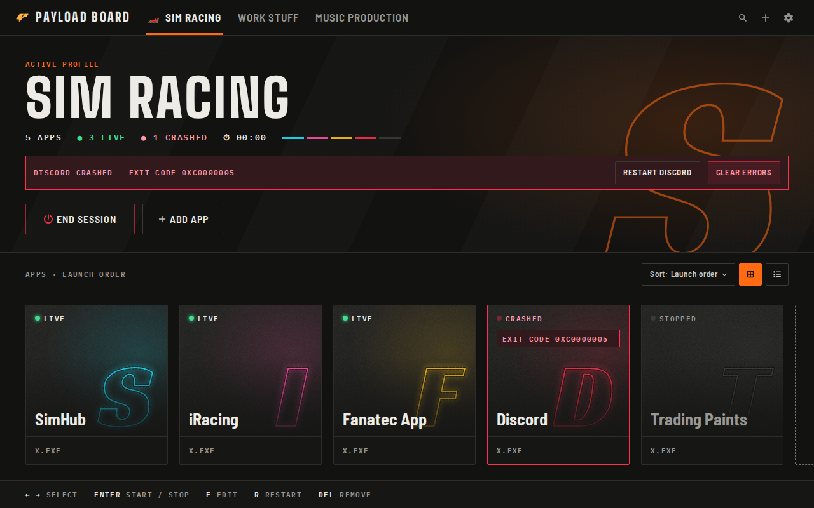

# Payload Board



A desktop app for managing sets of applications (profiles) — launch them in sequence, monitor their status in real time, and close everything with one click. Built for the "dark cockpit" aesthetic: functional data, no fluff.

Inspired by the pain of managing a dozen simracing apps that all had to be started in the right order before a session and closed one by one afterwards. Payload Board automates that.

## What it does

1. You create a named **profile** (e.g. `Racing`, `Work`, `Stream`).
2. You add **apps** to the profile — each with a launch order and optional CLI arguments.
3. You click **RUN SEQUENCE** → apps start one by one in your configured order.
4. The dashboard shows a live tile per app with its current status.
5. You can stop / restart / force-kill individual apps from their tile.
6. **END SESSION** gracefully closes everything in the profile (→ force-kill after 5 s timeout).
7. Profiles persist across restarts. Multiple profiles, switch from the left sidebar.

## Features

**Profiles & apps**
- Named profiles with emoji icon and description
- Multiple app entries per profile with launch order and CLI arguments
- Per-app process priority: Low / Normal / High
- Per-app "Launch minimised" toggle (Windows only)
- Tile and list view — switch between grid of cards or compact rows
- A→Z / Z→A sort
- Confirm dialogs before removing apps or deleting profiles

**Session management**
- **RUN SEQUENCE** disabled while a session is active
- Detect already-running processes — adopts existing process instead of double-launching
- Clear all errors at once — button appears when any app has crashed
- Per-process controls: start, stop, restart, open folder

**Status & monitoring**
- Status LED per tile: live (cyan glow) / stopped / crashed (red pulse + error message)
- Status bar: total / alive / crashed counts

**System tray**
- Tray icon always present with Show / Quit menu; left-click to restore
- **Start minimised to tray** — hide main window on launch (toggle in Settings)
- **Minimise on close** — close button hides to tray instead of quitting (toggle in Settings)
- **Launch on startup** — register as a Windows / Linux autostart entry (toggle in Settings)

**Artwork & appearance**
- SteamGridDB integration — search and assign game artwork as tile backgrounds; API key in Settings
- Local background image per app — pick any image file as a tile background
- Auto-fetch tile art when adding an app by name (if SteamGridDB API key is set)
- Theme selector: Purple / Grey (Settings → Appearance)

**Sidebar**
- Collapsible sidebar — chevron toggle in the Profiles header

**App discovery**
- Browse installed apps: Windows (registry), Linux (`.desktop` files)

**Storage**
- Persistent profiles (JSON, stored in platform app data dir)
- Custom config directory — change or reset in Settings
- Reset all data option in Settings

## Installation

### Windows

Download the latest release from [GitHub Releases](https://github.com/whosz/payload-board/releases):

| File | Description |
|------|-------------|
| `Payload-Board_x.x.x_x64-setup.exe` | Installer (recommended) |
| `Payload-Board_x.x.x_x64_en-US.msi` | MSI installer |
| `Payload-Board_x.x.x-portable-x64.zip` | Portable — extract and run, no install needed |

**Requirements:** Windows 10 or 11 (64-bit).  
Windows may show a SmartScreen warning on first run — click "More info → Run anyway".

### Linux

Pre-built `.deb` / `.AppImage` (Linux) are available on the [Releases](https://github.com/whosz/payload-board/releases) page.

Or build from source:

**Prerequisites:**
- [Node.js](https://nodejs.org) v18+
- [Rust](https://rustup.rs) stable toolchain

**Linux (Ubuntu / WSL2):**
```bash
sudo apt-get install -y libwebkit2gtk-4.1-dev libayatana-appindicator3-dev pkg-config build-essential
```

**Build:**
```bash
npm install
npm run tauri build
```

Output: `src-tauri/target/release/bundle/`

First Rust compile takes 5–10 minutes. Subsequent builds are fast.

## Usage

1. **Create a profile** — click `+ NEW PROFILE` in the sidebar, enter a name and optionally an emoji and description.
2. **Add apps** — select the profile, click `Add App`, browse to the executable or pick from the installed apps list. Set any CLI arguments and process priority if needed.
3. **Configure order** — apps launch in the order they appear; sort A→Z or rearrange manually.
4. **Run** — click `RUN SEQUENCE`. Watch the tiles turn live. The button is disabled while a session is active.
5. **End session** — click `END SESSION`. All profile apps receive a graceful close signal; any that don't exit within 5 s are force-killed.
6. **Tray** — the app lives in the system tray. Close the window to minimise it (if "Minimise on close" is enabled), or use Quit from the tray menu to exit fully.

## FAQ

**Why not Electron?**
Payload Board monitors and controls other processes. Using Electron would add ~150 MB RAM and meaningful CPU overhead to the very app that manages resource usage. Tauri's Rust backend uses ~5 MB RAM.

**Does it work on Linux?**
Yes — pre-built binaries are available on the Releases page. The "Browse installed apps" feature works on Windows (registry) and Linux (`.desktop` files). There is no macOS build.

**Can I import / export profiles?**
Not yet. Profiles are stored as plain JSON in your app data directory:
- Windows: `%APPDATA%\com.payload-board\`
- Linux: `~/.config/com.payload-board/`

You can also change the storage location in Settings → Storage.

**Steam launches a helper that exits immediately — how does Payload Board track the real process?**
After launch, Payload Board scans the process list for 10 seconds looking for a process matching the executable's filename. The first match is assigned as the tracked PID.

## Tech stack

| Layer | Technology |
|-------|-----------|
| Desktop shell | [Tauri 2](https://tauri.app) |
| Backend | Rust stable |
| Frontend | React 18 + TypeScript |
| Build | Vite |
| Styling | Tailwind CSS v4 |
| Styling tokens | CSS custom properties (`--color-*`); Purple / Grey themes via `[data-theme]` |
| Components | shadcn/ui (heavily customised) |
| Fonts | Exo (headers/labels) + Inter (body/buttons) |
| Icons | FontAwesome 6 Free |
| Persistence | `tauri-plugin-store` (JSON) |
