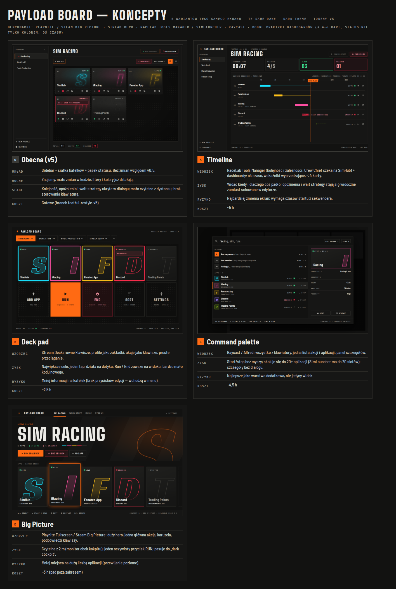

# Big Picture layout + Command Palette (v6)

**Status:** planned (decisions D1–D6 confirmed 2026-11-14; 4b overlay deferred), starts after v5 is QA'd in the real Tauri window. Execution plan for agents: [agent-workflow.md](agent-workflow.md). Stack on `feat/ui-restyle-v5` (or on `main` once v5 is merged).
**Builds on:** [ui-restyle-v5.md](ui-restyle-v5.md) (tokens, themes, tiles, controls).

## Goal

Turn the dashboard into a "cockpit" screen that is readable from ~2 m and fully drivable from the keyboard, **without changing what the app does**: profiles, apps, sequence, process control stay as they are.

- **D — Big Picture** becomes the default view: big profile hero with one contextual primary action, tile carousel underneath.
- **C — Command Palette** is added on top: `Ctrl+K`, later a global shortcut that works over a fullscreen game.
- B (Deck pad) and A (Timeline) are **not** in scope; A survives as a small launch-order strip in the hero.

Concepts (static mockups, dark theme): 
[D — Big Picture](../assets/concepts/D-big-picture.png) · [C — Command palette](../assets/concepts/C-command-palette.png)

## Why this direction (research, directional only — mostly reviews and blogs, no user studies)

| Pattern | Source type | What we take |
|---------|-------------|--------------|
| Fullscreen, controller/distance-first mode | Playnite Fullscreen, Steam Big Picture | Hero + carousel + key hints |
| Profiles as sets of big uniform keys | Stream Deck reviews | Large targets, one obvious action |
| Ordered start with dependencies | RaceLab Tools Manager, SimLauncher | Launch-order strip, step progress |
| Keyboard-first command palette | Raycast / Alfred | One list for actions + apps + profiles |
| At-a-glance status | Dashboard UX guides (Smashing, Cloudscape) | ≤ 4–6 top-level items, status never by colour alone |

## Constraints found in the repo

- Window: default 1200×800, **min 900×600** (`src-tauri/tauri.conf.json`). Concept D needs ~730 px of height → hero needs a **compact mode** below ~700 px (name 64 px, no stats row spacing, carousel 240 px).
- `src-tauri` has only the `tray-icon` feature: **no** `global-shortcut` or `notification` plugin yet (Cargo.toml, capabilities/default.json must be extended).
- `Profile.color_accent` exists in `types.ts` but is unused — free hook for per-profile tint.
- The running sequence is a JS loop with `setTimeout` in `App.tsx` (`handleRunSequence`): no shared state, no cancel, and a hidden WebView2 window may throttle timers — **risky for global shortcuts**. Decision D1 below moves it to Rust.
- Changing the profile JSON needs a Rust migration → every new field must be optional with `#[serde(default)]`. **Ask before** phases 5 and 2b.
- All new tokens go to `:root` / `[data-theme]`, never `@theme inline` (see v5 notes).

## Decisions

| # | Decision | Status |
|---|----------|--------|
| D1 | **Sequencer moves to Rust** (`run_sequence`, `cancel_sequence`, events `sequence_progress`). Frontend becomes a thin `useSequence` client. Needed for cancel, hero states, global shortcuts with a hidden window, and later auto-restart. Alternative (keep JS loop) is ~3 h cheaper but fragile | **confirmed** |
| D2 | **All shortcuts are user-configurable in Settings** (global and in-window), with conflict/invalid detection, reset to default and an "Enable global shortcuts" master switch (they can clash with game binds) | confirmed |
| D3 | **Shortcuts work globally** (OS-level, window hidden or unfocused). Actions without UI (run / end) work anywhere with a toast as feedback; palette needs the window → the shortcut shows and focuses the window (4a). **Overlay over games (4b) is deferred** — removed from scope for now | confirmed |
| D4 | Default shortcuts: palette `Ctrl+Shift+Space` (global), run sequence `Ctrl+Alt+R`, end session `Ctrl+Alt+E`, in-window palette `Ctrl+K`. **Global End session needs a second press within 2 s** (toast "Press again to end session") so a stray key can't kill a race | confirmed |
| D5 | **Hero**: height-based, not scroll-based. ≥ 700 px window height → full hero (~330 px). < 700 px → slim 72 px sticky hero bar (name, live/crashed counts, the same contextual primary button); carousel gets the remaining height. Predictable, no scroll jank, works at the 900×600 minimum | decided |
| D6 | Palette default in-window shortcut `Ctrl+K`; also `Ctrl+P` alias | confirmed |

## Phases

| # | Scope | Main files | Est. |
|---|-------|-----------|------|
| 0 | QA v5 in the real Tauri window (fonts on Windows, SteamGridDB art, keyboard-only pass) — **prerequisite** | — | 30 min |
| S | **Rust sequencer** + events + thin `useSequence` client (D1) | `src-tauri/src/sequencer.rs`, `commands/`, `hooks/useSequence.ts` | 3 h |
| 1 | **Big Picture layout**, hero states, keyboard focus | `Hero.tsx`, `AppCarousel.tsx`, `ProfileTabs.tsx`, `App.tsx` | 3.5 h |
| 2 | Profile accent and cover | `ProfileEditor.tsx`, hero | 1 h |
| 3 | **Command Palette** (in-window) + action registry | `CommandPalette.tsx`, `lib/actions.ts` | 3 h |
| 4 | **Shortcuts**: global registration, storage, conflict handling, Settings UI (record key), master switch | `src-tauri/src/shortcuts.rs`, `SettingsPanel.tsx` / `ShortcutsSection.tsx` | 4 h |
| 4b | ~~Palette overlay over games~~ — **deferred** (see Not now) | — | — |
| 5 | Crash toast + auto-restart | notification plugin, Rust, settings | 2 h |
| 6 | Mini mode (400–480 px) | layout variant | 2 h |

**Core (0, S, 1, 2, 3, 4): ~15 h** plus 1–2 feedback rounds. With 5 and 6: ~19 h. (4b would add ~3 h + a Windows spike.) (Revised twice vs. chat: global shortcuts need new plugins and a Rust sequencer.) Wall-clock can be shorter with parallel agents, token cost higher — see [agent-workflow.md](agent-workflow.md).

### Phase S — Rust sequencer
- [x] `run_sequence(profile_id)`: iterate enabled apps in order, skip running ones, honour `launch_delay_ms` (tokio sleep), emit `sequence_progress { profile_id, state, step, total, app_id? }`
- [x] `cancel_sequence(profile_id)`; one sequence per profile at a time; errors become `process_status_changed` with `crashed` + message (same as today)
- [x] Frontend `useSequence`: `idle | launching(step,total) | running | crashed`, `run()`, `cancel()`; `handleRunSequence` in `App.tsx` removed
- [x] Behaviour identical (**one change:** launch order is now `order`, so the A→Z/Z→A sort no longer reorders the launch; list sorting is display-only) to today for a plain run (manual test list)
- [ ] Wait strategies (`wait_for_window`, `wait_seconds`) stay out of scope here (still in `planned/sequencer.md`)
- Done on `feat/big-picture`: Rust tests for ordering and cancellable sleep pass; `start_app_inner` extracted from the `start_app` command; `process_status_changed` now carries optional `error_message`. Windows-only check pending: sequence with delays and cancel in the real app.

### Phase 1 — Big Picture layout

- [x] Consume `useSequence` from phase S (hero states: idle / launching / running / crashed)
- [x] `Hero.tsx`: profile name (Big Shoulders), stats (apps / live / crashed), launch-order strip, **one contextual primary button**:
  - idle → RUN SEQUENCE · launching → step progress + CANCEL · running → END SESSION + session time · crashed → red banner + "Restart <app>"
- [x] Hero per D5: full ≥ 700 px height, slim 72 px sticky bar below (no scroll-driven behaviour)
- [x] `AppCarousel.tsx` (measured: at 900×600 the current grid fits one column): horizontal strip; auto-switch to wrapped grid when > 7 apps (or window too narrow)
- [x] Tile: taller variant (224×300) reusing `TileBackdrop`, `AppControls` appears for the focused tile only
- [x] Roving focus (`tabindex`), arrows move, `Enter` start/stop, `E` edit, `R` restart, `Del` remove (with the existing confirm dialog)
- [x] Fix the control-border contrast gap (`--color-border-control`, see ui-restyle-v5.md known gaps) while touching inputs and the Settings screen
- [x] Key-hint footer replaces the old status bar counters (counters move into the hero); hints hide when a dialog is open
- [x] Keep list view as an alternative (view toggle stays); sidebar becomes top tabs (`ProfileList` → `ProfileTabs`), sidebar collapse logic removed
- [x] Reduced motion: handled by the global `prefers-reduced-motion` rule (transitions and animations effectively off)
- Done on `feat/big-picture`: `ProfileTabs`, `Hero` (idle / launching / running / crashed), `AppCarousel` + `PosterTile` (roving focus, wraps above 7 apps), `AppsToolbar`, `KeyHints`, `useSessionSeconds`, `lib/appArt.ts`. Compact hero below 760 px window height (single row, crash banner hidden — the tile still shows the error). Control-border contrast fixed (`--color-border-control`, ≥ 3:1 in all themes; `qa:contrast` passes). `Switch` restyled for real (it was still round before).
- Modals share one chrome in `ui/dialog.tsx` (`DialogContent width/tone`, `ModalHeader`, `ModalFooter`): accent top edge, display-font title that is also the accessible name, 32 px close button, right-aligned footer. Profile edit/delete icons in the hero show only on hover or keyboard focus of the name row.
- `ProfileList.tsx`, `StatusBar.tsx`, `AppTile.tsx` are no longer used by the app; they are kept only because the dev-only `DesignReference.tsx` imports them. Delete all four together when that page goes.
- Verified in headless Chromium with the Tauri mock (hero states, 1280×800 and 900×600, three themes, keyboard focus). **Not yet verified in the real Tauri window / on Windows:** sequence with delays and cancel, roving-focus keys in WebView2.

### Phase 2 — Profile accent and cover
- [x] 2a: use `color_accent` (already in type) as hero tint; picker in `ProfileEditor` (5 presets + default accent)
- [ ] 2b: optional profile cover image (reuse SteamGridDB / local picker). **New optional field → Rust migration, ask first.** Fallback: big first letter
- Done: `lib/accent.ts` (presets, readable text colour, darkening in the light theme), colour picker in `ProfileEditor`, accent applied on `<html>` so tabs, hero, focus ring and buttons follow the active profile. **2b (cover image) is NOT done** — it adds a new optional profile field, so it waits for your OK.

### Phase 3 — Command Palette (in-window)
- [x] `CommandPalette.tsx` on the existing base-ui `Dialog`; `Ctrl+K` / `Ctrl+P` to open (toggle), `Esc` to close, header button
- [x] Sections: Actions, Apps (Enter start/stop, Ctrl+R restart, Ctrl+E edit, Ctrl+O folder), Profiles ("Switch to …"). *Recent* not built
- [x] Filter: simple scored substring match (no new dependency); `↑↓`, `Enter`, `Tab` for details panel
- [x] A11y: combobox/listbox pattern (`role`, `aria-activedescendant`, live region for result count); focus returns to the opener
- [x] Details panel from existing `AppEntry` fields (path, args, delay, wait, priority)
- [ ] (moves to phase 4) Also wire the in-app shortcuts from `planned/hotkeys.md` (`Ctrl+R`, `Ctrl+.`, `Ctrl+N`) — same action registry feeds palette and shortcuts
- Done: `lib/palette.ts` (items, scoring, ranking: groups ordered by best match, first enabled item preselected), `CommandPalette.tsx`. 10-step keyboard/ARIA check passes in headless Chromium (open, focus, arrows, activedescendant, groups, no results, Enter, Esc, toggle). Not tested with a real screen reader. The palette hotkey is hard-coded for now; phase 4 makes it configurable.

### Phase 4 — Shortcuts (global + configurable)
- [x] **Action registry** (`lib/actions.ts`, shared with the palette): `id`, `title`, `scope: 'global' | 'window'`, `defaultAccelerator`, `run(ctx)`. Actions: `palette`, `run_sequence`, `end_session`, `add_app`, `new_profile`, `settings`
- [x] Rust `shortcuts.rs` with `tauri-plugin-global-shortcut`: register from stored settings at startup; on trigger emit `shortcut_triggered { action }` (palette: show + focus main window first); `run`/`end` call the Rust sequencer / `stop_all` directly so they work with the window hidden
- [x] Commands: `get_shortcuts`, `set_shortcut(action, accelerator)`, `reset_shortcut(action)`, `set_global_shortcuts_enabled(bool)`; errors typed `Invalid | Conflict | Taken` (OS refused registration)
- [x] Storage in the existing settings store; accelerator format = Tauri (`CommandOrControl+Shift+Space`)
- [x] **Settings → Shortcuts** section: one row per action (label, current keys, scope badge, Change = press-to-record, Reset, Clear), master switch "Enable global shortcuts", inline error for conflicts/invalid, shows which are global vs window-only
- [x] Global End session needs a second press within 2 s (D4); toast confirms every global action
- [x] In-window shortcuts (`Ctrl+K`, `Ctrl+R`, `Ctrl+.`, `Ctrl+N`, …) read the same registry, so changing them in Settings takes effect immediately; guard against firing while a dialog is open
- [ ] Risk to verify early (Windows): re-registering after a failed attempt; shortcut still firing after the window is minimised to tray
- Done on `feat/big-picture`:
  - Rust `shortcuts.rs` (`tauri-plugin-global-shortcut` 2.x): `get_shortcuts`, `set_shortcut` (typed errors `invalid | conflict | taken`, rolls back when the OS refuses), `reset_shortcut`, `set_global_shortcuts_enabled`, `suspend_global_shortcuts` (paused while recording a key), `set_active_profile` (so global run/end know the profile with the window hidden). Persisted in the settings store. Events: `shortcut_triggered`, `shortcut_feedback`. `start_sequence` and `stop_all_inner` extracted so the shortcut handler calls them directly.
  - Accelerators are `CommandOrControl+Alt+KeyR`-style (`KeyboardEvent.code` names). Defaults: palette anywhere `Ctrl+Shift+Space`, run `Ctrl+Alt+R`, end session `Ctrl+Alt+E` (second press within 2 s), window: palette `Ctrl+K`, add app `Ctrl+N`, new profile `Ctrl+Shift+N`, settings `Ctrl+,`. (`Ctrl+P` alias from D6 dropped: every shortcut is now a single configurable binding.)
  - Frontend: `lib/shortcuts.ts`, `hooks/useShortcuts.ts` (window handlers; global ones fall back to the window only when OS registration is off or failed), Settings → Shortcuts (`ShortcutsSection`: master switch, press-to-record, Reset/Clear, conflict and invalid messages). `Switch` now takes an `aria-label` (the Settings switches had no accessible name).
  - 4 Rust tests (defaults parse and are unique, globals need a modifier) + `npm run qa:flows` (17 browser checks: palette and shortcut settings).
- **Windows checklist (not testable in WSL):** global shortcuts fire with the window hidden to tray and while a game has focus; a taken/invalid key shows an error and the old binding stays; run/end via shortcut (End needs the second press); disabling the master switch frees the keys; palette shortcut brings the window to the front.
- Not built: feedback while the window is hidden is only a toast inside the window — a system notification arrives with phase 5.

### Phase 5 — Crash toast + auto-restart (ask before touching data format)
- [x] `tauri-plugin-notification`: system toast on crash when the window is hidden
- [x] Optional auto-restart: per-app `restart_on_crash` + `max_retries` (optional fields, `#[serde(default)]`), global toggle in Settings; Rust side owns the retry counter and emits the existing `process_status_changed` event
- Done (data-format change approved): `AppEntry.restart_on_crash` / `max_retries` (Rust `Option`, absent in old files = off). `crash.rs`: system notification on crash only when the window isn't in front (`tauri-plugin-notification`), retry policy (`decide`, unit-tested: default 3 attempts, clamp 1–10, global master switch, per-app opt-in), 2 s delay, budget reset after 60 s of stable running or a manual start, "gave up" notification. Two Settings switches (notify, allow auto-restart; generic allow-listed `get/set_bool_setting`). Shortcut feedback also becomes a system notification when the window is hidden. App editor: "Restart if it crashes" + max attempts (1/2/3/5).
- **Windows check:** notification appears (and not while the window is focused); a killed app is restarted after ~2 s up to the limit, then "keeps crashing"; manual Start resets the budget.

### Phase 6 — Mini mode
- [x] Below ~520 px width: status + RUN/END only; reachable by resizing (no separate window yet)
- Done: window minimum lowered to 360×260 (`tauri.conf.json`); below 560 px width only the hero stays (name, live/crashed counters, crash banner, one primary button); carousel, toolbar, key hints, Add app, profile edit icons and the brand text are hidden. Checked at 400×560 and 360×300. No separate app list in mini mode (by design: status + primary action only).

## Phase 7 — Languages (added later, done)

- [x] English (source), Polish, German, Spanish, French. Language picker in Settings → Appearance (default: browser language, stored in `localStorage`; `<html lang>` follows).
- [x] Own tiny i18n (`src/i18n/index.ts`): English text is the key, `t()`/`tx()`, `{placeholders}`, plural entries via `Intl.PluralRules` (needed for Polish few/many). No new dependency.
- [x] ~190 strings wrapped across the UI; Rust-side messages (crash notifications, shortcut feedback) translated in `src-tauri/src/i18n.rs`, language pushed to Rust with `set_language`.
- [x] `npm run qa:i18n` fails on a missing translation, differing placeholders or missing plural forms.
- **Translation quality:** written by the assistant, not by native speakers or a professional translator. Terminology chosen for games/launchers (profil/Profil/perfil/profil, sekwencja/Sequenz/secuencia/séquence, skrót/Tastenkürzel/atajo/raccourci). German uses the informal "du", Spanish neutral phrasing, French "vous" and Polish impersonal forms. Worth a native read-through before a release.
- Profile and app names, executable names and technical error text coming from the OS stay as they are.

## Acceptance criteria

- [ ] Full flow without a mouse: open palette → start an app → close → run/stop sequence
- [ ] Works at 900×600 and 1200×800, three themes
- [ ] Every shortcut can be changed, reset and disabled in Settings; invalid/conflicting keys show a clear message and never leave the app without a working palette shortcut
- [ ] Global run/end work with the window hidden (tray) and while another app has focus
- [ ] WCAG 2.2 AA as in v5 (contrast, 24 px targets, visible focus, status not by colour alone, reduced motion) + palette ARIA pattern
- [ ] No regression in existing process control and sequence behaviour (manual test list below)
- [ ] `npm run build` clean; verified in the real Tauri window, not only in the browser mock

**Manual test list:** global run / end with window hidden · change a shortcut and use it · conflict with an existing shortcut · run sequence with delays · cancel mid-sequence · stop one app · crash an app (kill process) · END SESSION with confirm · add/edit/remove app · profile switch · settings dialogs · tray minimise/restore.

## Not now

- **Palette overlay over games (4b)** — deferred by decision. If revived: 30-min Windows spike first (frameless always-on-top window over borderless-windowed vs exclusive-fullscreen; true exclusive fullscreen usually blocks overlays), then a separate frameless window with state via Tauri events. Until then the palette shortcut brings the main window to the front; run/end shortcuts work anywhere.
- Gamepad/wheel navigation (Gamepad API works in the webview, but wheel/button-box inputs may clash with the game)
- Per-tile CPU/RAM sparklines (planned in `planned/monitoring.md`, would add noise to the hero)
- Sounds
- Deck pad and full Timeline views (revisit after this ships)

## Open questions

None. (4b deferred.)

## Suggested branches / commits

`feat/big-picture` from `feat/ui-restyle-v5`; one commit per phase; ship as v0.7.0 (v0.6.0 = restyle).
